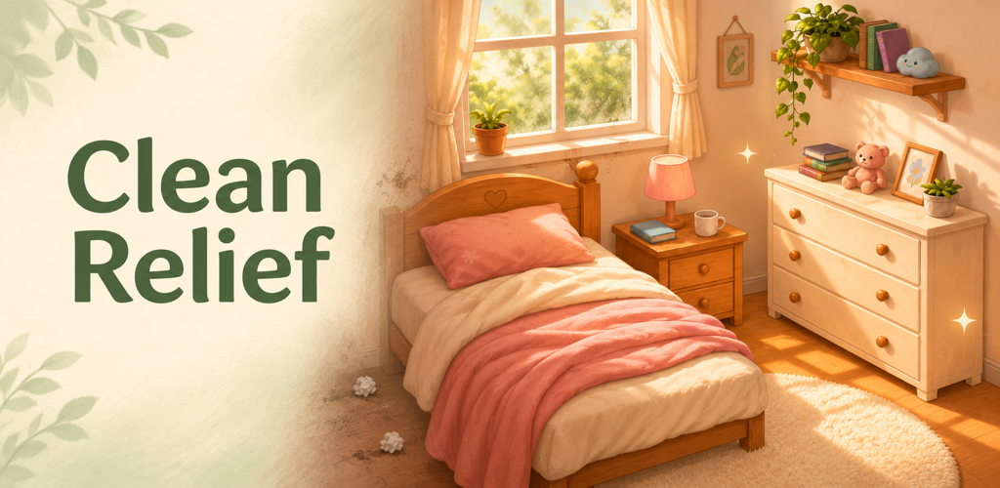

클린 릴리프(Clean Relief)는 Flutter로 만든 Android 청소 게임입니다. 침실과 주방의 쓰레기와 얼룩을 정리하고, 세탁과 설거지를 단계별 터치 조작으로 즐길 수 있도록 만들었습니다.

## 프로젝트 개요

- 한국어 이름: 클린 릴리프: 방청소 게임
- 영어 이름: Clean Relief: Cozy Cleaning
- 플랫폼 / 배포 대상: Android / Google Play
- 장르: 캐주얼 청소 시뮬레이션
- 개발 언어 / UI: Dart / Flutter
- 지원 언어: 한국어, 영어
- 출시 후보: 1.0.19(22)
- 출시 기록: 2026년 11월 6일 프로덕션 심사 신청 완료. 이 기록은 정식 게시 완료를 뜻하지 않습니다.

## 게임 진행

1. 침실의 창문을 열고 방과 서랍 속 쓰레기를 쓰레기통으로 옮깁니다.
2. 가구와 바닥의 얼룩을 문질러 닦습니다.
3. 이불과 러그를 세탁하고 침실을 마칩니다.
4. 주방으로 이동해 찬장과 바닥의 쓰레기, 표면 얼룩을 정리합니다.
5. 싱크대의 접시를 설거지하고 행주와 발매트를 세탁합니다.
6. 완료한 방은 다시하기로 처음부터 플레이할 수 있습니다.

세탁은 **물 적시기 → 세제 → 솔질 → 헹굼 → 물기 제거 → 건조**의 6단계로 구성했습니다. 설거지는 **먼저 헹구기 → 거품 내기 → 깨끗이 헹구기**의 3단계입니다. 방 사이를 이동하거나 앱을 다시 실행해도 저장된 진행을 복원합니다.

## 사용 기술

| 기술 | 역할 |
| --- | --- |
| Flutter / Dart | 화면, 터치 조작, 청소 단계 및 진행 상태 관리 |
| shared_preferences | 기기에 진행 상황과 설정 저장 |
| google_mobile_ads / Google AdMob | 전면 광고와 선택형 보상 광고 |
| Google UMP SDK | 광고 관련 개인정보 보호 선택 처리 |
| Android App Bundle | Google Play 배포 파일 |
| HTTPS 공개 정책 | 최소 지원 버전 확인 및 업데이트 안내 |

## 프로그램 구조

게임 화면과 청소 동작, 저장소, 광고, 업데이트 검사를 다음과 같이 나눴습니다.

| 파일 / 영역 | 담당 기능 |
| --- | --- |
| `lib/main.dart` | 앱 진입점, 침실 화면, 방 전환과 게임 UI |
| `lib/kitchen_room.dart`, `lib/kitchen_layout.dart` | 주방 오브젝트와 배치·레이어 구성 |
| `lib/washing_screen.dart`, `lib/washing_surface.dart` | 세탁 단계와 문지르기·헹굼 표현 |
| `lib/dishwashing_screen.dart`, `lib/dish_surface.dart` | 접시 설거지 단계와 표면 상태 |
| `lib/progress_store.dart` | 버전이 있는 진행 스냅샷의 로컬 저장·읽기 |
| `lib/ad_policy.dart` | 방 전체에서 공유하는 힌트 수와 광고 표시 간격 |
| `lib/admob_gateway.dart` | Google 광고 SDK 초기화·광고 요청·보상 처리 |
| `lib/update_gate.dart`, `lib/update_policy.dart` | 시작·복귀 시 최소 버전 검사와 업데이트 화면 |
| `lib/privacy_policy.dart` | 앱 안에서 읽는 한국어·영어 개인정보처리방침 |
| `assets/game/` | 방 배경, 오브젝트, 도구 등 게임 이미지 |
| `test/` | 조작, 청소 진행, 광고 정책, 업데이트 검사 등의 테스트 |

주방 코드는 `main.dart`의 일부로 연결됩니다. 화면의 배경과 조작 가능한 오브젝트를 구분해 쓰레기를 끌거나 얼룩을 닦을 때 개별 상태를 바꾸도록 구성했습니다.

## 저장과 업데이트

회원가입이나 개발자 서버 없이 게임 진행과 설정을 기기에 저장합니다. 방별 청소 상태와 세탁·설거지 중간 진행을 복원하므로 짧게 나누어 플레이할 수 있습니다.

Android 앱은 시작하거나 다시 활성화될 때 공개된 최소 버전 정책을 확인합니다. 설치 버전이 최소 지원 버전보다 낮으면 게임 대신 업데이트 안내를 표시하고 Google Play로 연결합니다.

## 광고와 개인정보 보호

처음 다음 방으로 이동할 때 전면 광고를 표시할 수 있고, 무료 힌트 5회를 모두 사용하면 선택형 보상 광고로 힌트 5회를 충전할 수 있습니다. 광고가 준비되지 않으면 게임 진행을 막지 않습니다.

출시 후보에는 모든 사용자를 대상으로 아동 보호 설정, 비맞춤형 광고, G등급 광고 제한을 적용했습니다. 연령 입력 절차는 없으며 Android 광고 ID 접근 권한을 제거했습니다. Google SDK가 처리할 수 있는 데이터와 보관·삭제 안내는 [개인정보처리방침](/policies/clean-relief/)에 설명했습니다.

## 출시 준비 검증

1.0.19(22) 출시 후보 준비 과정에서 `flutter analyze`와 관련 테스트 36개가 통과했습니다. AAB의 서명·버전·프로덕션 광고 설정과 광고 ID 권한 제거를 확인했고, 승인된 한국어·영어 스토어 설명과 기기별 스크린샷을 준비했습니다.

같은 AAB를 내부 테스트에 배포하고 프로덕션 심사를 신청했습니다.

## 관련 페이지

- [앱 소개와 게임 스크린샷](/apps/clean-relief/)
- [개인정보처리방침](/policies/clean-relief/)
- [개발 기록 목록](/dev-log/)
