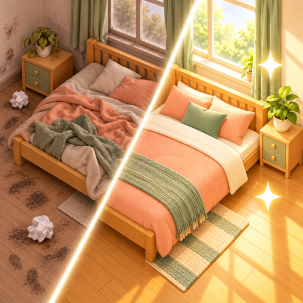
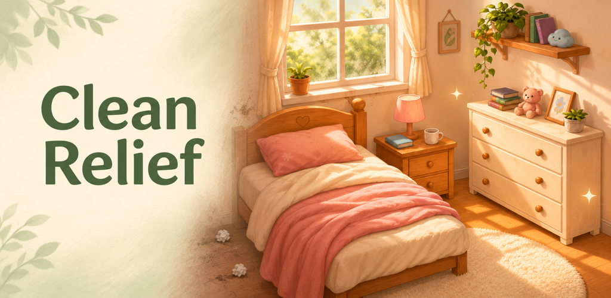
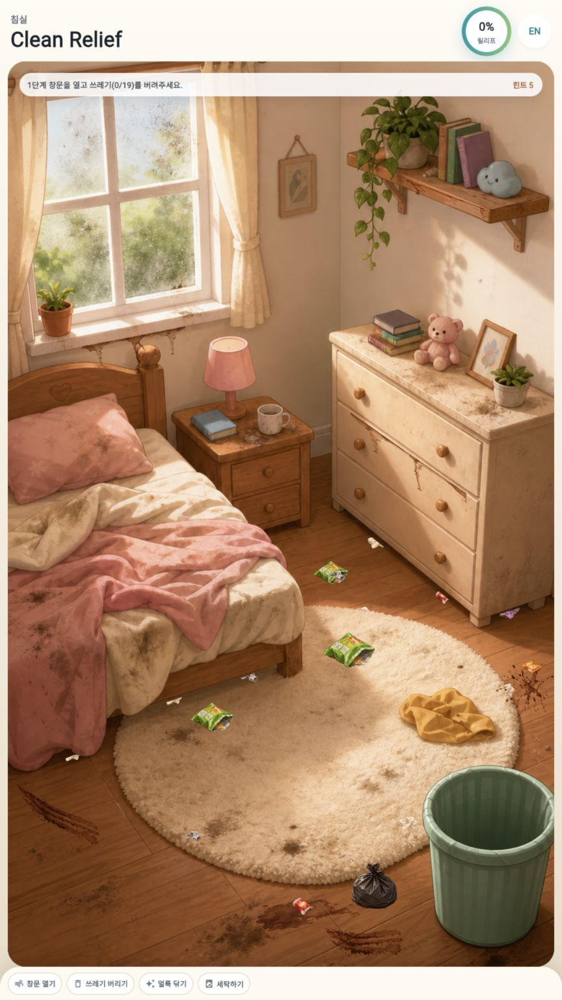
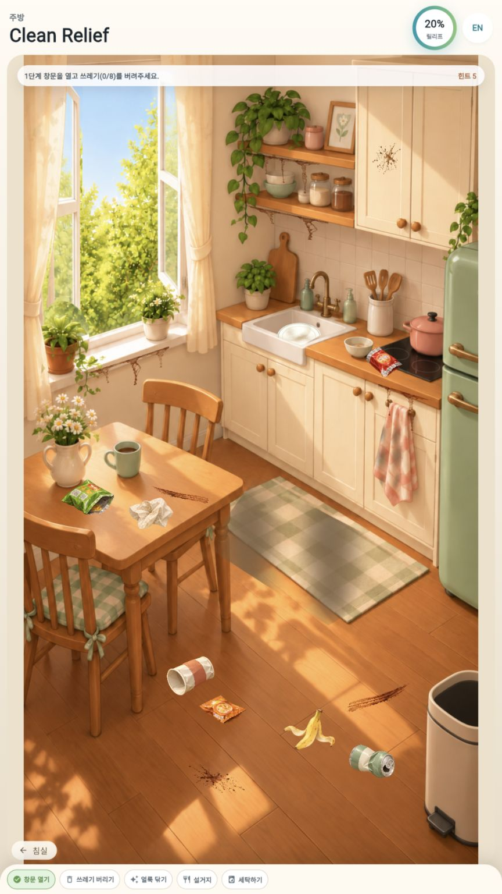
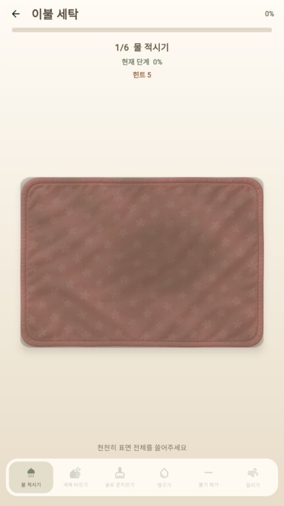
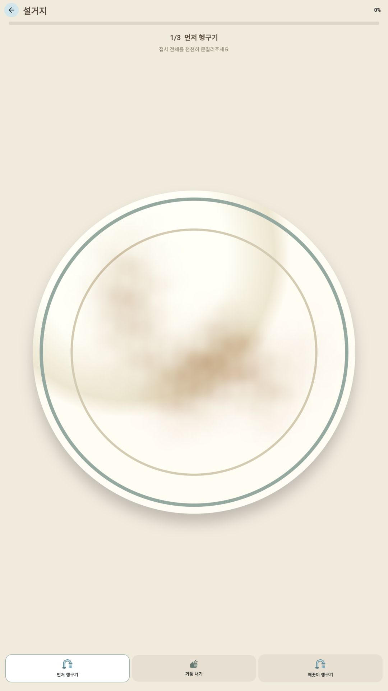

클린 릴리프(Clean Relief: Cozy Cleaning)는 어질러진 침실과 주방을 하나씩 정리하는 Android 청소 게임입니다. 쓰레기를 치우고 얼룩을 닦으며 아늑한 공간을 만들어 보세요.

<figure>
  
</figure>

## 게임 화면

침실과 주방을 정리하고, 빨래와 설거지를 차근차근 마무리하세요. 아래 이미지를 누르면 크게 볼 수 있습니다.

  <figure style="display: flex; flex-direction: column; align-items: center; margin: 0; text-align: center;">
    
    <figcaption style="width: 100%; margin-top: 0.5rem;">침실 청소 · 휴대폰 화면</figcaption>
  </figure>
  <figure style="display: flex; flex-direction: column; align-items: center; margin: 0; text-align: center;">
    
    <figcaption style="width: 100%; margin-top: 0.5rem;">주방 정리 · 휴대폰 화면</figcaption>
  </figure>
  <figure style="display: flex; flex-direction: column; align-items: center; margin: 0; text-align: center;">
    
    <figcaption style="width: 100%; margin-top: 0.5rem;">이불 세탁 · 태블릿 화면</figcaption>
  </figure>
  <figure style="display: flex; flex-direction: column; align-items: center; margin: 0; text-align: center;">
    
    <figcaption style="width: 100%; margin-top: 0.5rem;">접시 설거지 · 태블릿 화면</figcaption>
  </figure>

## 주요 기능

- 침실과 서랍 속 쓰레기를 쓰레기통으로 옮기고 가구와 바닥의 얼룩 닦기
- 침실을 마친 뒤 주방에서 이어지는 청소
- 이불, 러그, 행주, 발매트를 물 적시기부터 건조까지 단계별로 세탁
- 주방 싱크대에서 접시를 헹구고 거품을 내어 설거지
- 청소 대상을 찾는 힌트와 완료한 방 다시하기
- 기기 내 진행 상황 자동 저장
- 한국어·영어 지원

## 광고와 개인정보

앱에는 광고가 포함됩니다. 첫 방 이동 시 전면 광고가 표시될 수 있으며, 무료 힌트를 소진한 뒤에는 선택적으로 보상형 광고를 보고 힌트를 충전할 수 있습니다.

연령 확인 절차 없이 모든 사용자에게 아동 보호 설정, 비맞춤형 광고, G등급 광고 제한을 적용해 광고를 요청합니다. Android 광고 ID 접근 권한은 제거했습니다. 실제 광고 제공 여부는 광고 공급 및 Google SDK의 개인정보 보호 설정에 따라 달라집니다.

회원가입이나 로그인은 필요하지 않습니다. 게임 진행과 설정은 기기에 저장하며 개발자 서버로 전송하지 않습니다. Google 광고 SDK 등이 처리할 수 있는 정보와 삭제 방법은 [개인정보처리방침](/policies/clean-relief/)에서 확인할 수 있습니다.

## 서비스 정보

- 플랫폼: Android
- 출시 후보 버전: 1.0.19(22)
- 출시 상태: 2026년 11월 6일 Google Play 프로덕션 심사 신청 완료. 정식 게시 여부는 아직 확인되지 않았습니다.
- 출시 신청 지역: 지원 가능한 178개 국가·지역
- 문의: [sicorp.apps@gmail.com](mailto:sicorp.apps@gmail.com)

앱은 시작하거나 다시 활성화될 때 최소 지원 버전을 확인하며, 지원이 종료된 버전에는 Google Play 업데이트 안내를 표시합니다.

## 관련 문서

- [프로젝트 정보와 프로그램 구조](/devlog/clean-relief-project-info/)

- [개인정보처리방침](/policies/clean-relief/)
- [앱 목록](/apps/)
